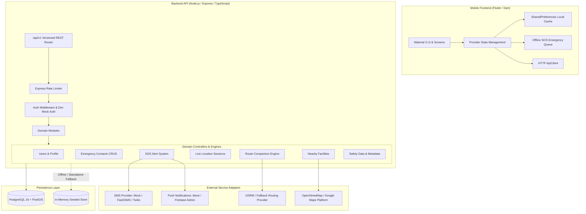
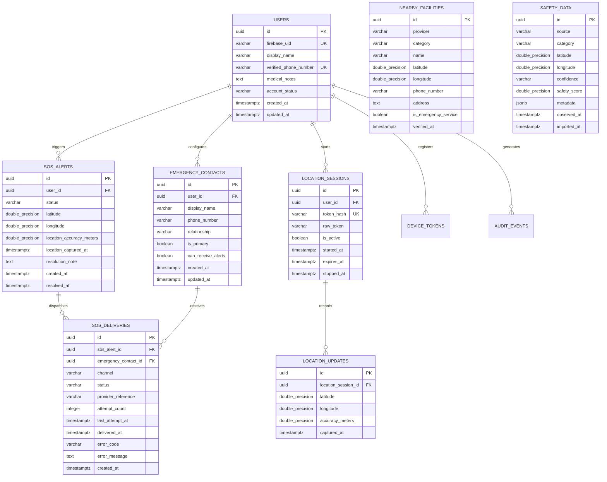

# AEGIS — Advanced Emergency and Intelligent Safety
## System Architecture & Technical Specification

### 1. Architectural Overview
AEGIS is an independent personal safety and emergency-response platform designed for women and vulnerable individuals in urban areas. The system emphasizes:
- **Resilient Emergency Communication**: SOS alert creation with automatic fallback when GPS or high-speed connectivity is degraded.
- **Privacy by Design**: Cryptographic token hashing, unguessable live-location tokens, strict user-data isolation, and zero background tracking without explicit user consent.
- **Transparent Route Safety**: Grounded in audited public facilities (police stations, hospitals, 24x7 pharmacies) and municipal streetlighting audits in Chennai, Tamil Nadu.

---

### 2. Database Entity Relationship (ER) Diagram

---

### 3. Chennai Urban Focus
The first release implements geographic grounding in the Chennai Metropolitan Area (Tamil Nadu, India):
- **Key Transit Hubs**: Koyambedu Bus Terminus (CMBT), Chennai Central, Guindy, Vadapalani 100ft Road, Ramapuram.
- **Verified Emergency Services**:
  - Police Stations: K10 Koyambedu, J3 Guindy, R1 Mambalam (T. Nagar), Ramapuram PS, E2 Royapettah.
  - Hospitals: Rajiv Gandhi Govt General Hospital, MIOT International, SIMS Hospital, Apollo Hospitals Greams Road.
  - 24x7 Pharmacies: Apollo Pharmacy Koyambedu & Vadapalani, MedPlus Ramapuram.
- **Authoritative Streetlighting Audit**: Greater Chennai Corporation Smart LED streetlighting layers covering primary arterial corridors.
